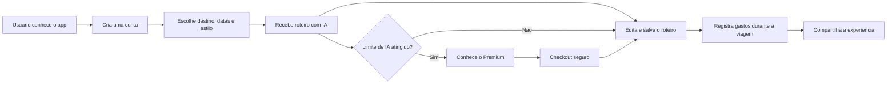
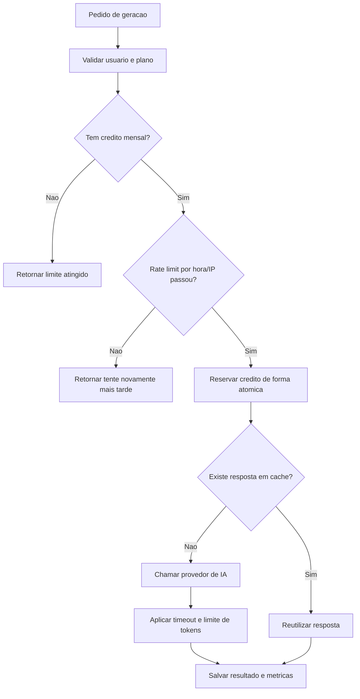
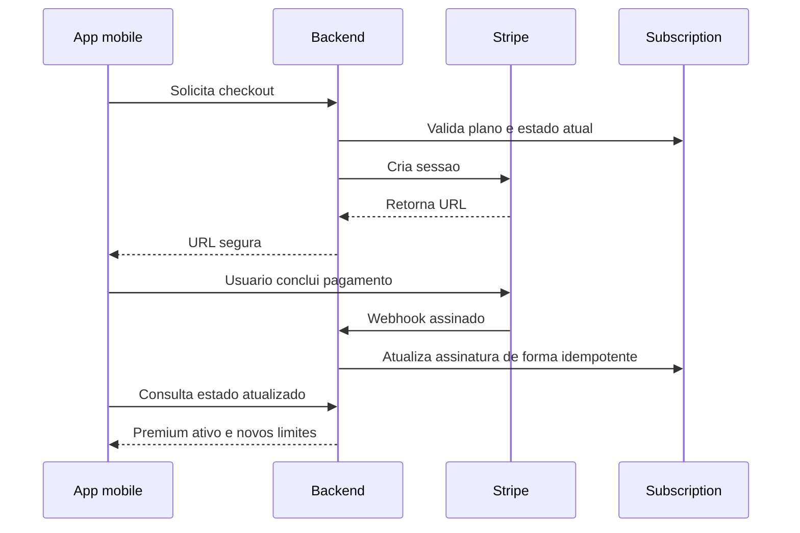
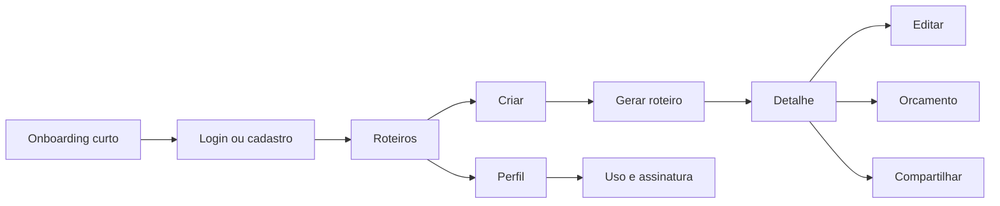

# Guia do Aventureiro

## Plano visual para MVP, lancamento e controle de custos de IA

**Versao do documento:** 1.1 (atualizado para estrategia web-first em 10/11/2026)
**Objetivo:** transformar a base atual em um MVP simples de lancar, facil de entender e financeiramente controlavel.

> **Mudanca de estrategia (v1.1):** a versao WEB virou a prioridade de lancamento.
> O app mobile continua no mesmo codigo (Expo + react-native-web) e sai depois,
> sem burocracia de loja no primeiro momento. Detalhes na secao 10.1.

---

## 1. Decisao principal

O Guia do Aventureiro ja possui uma base tecnica ampla. O proximo passo nao e adicionar mais funcionalidades. E consolidar uma experiencia central:

> **Criar um roteiro de viagem personalizado, ajustar os detalhes e acompanhar os gastos da viagem em um so lugar.**

Essa promessa combina tres momentos claros:

1. **Planejar:** a IA cria uma primeira versao do roteiro.
2. **Organizar:** o viajante edita dias, atividades e preferencias.
3. **Acompanhar:** o viajante registra gastos e compara o planejado com o realizado.

O sistema de planos continua essencial. Ele possui duas funcoes:

- Monetizar os recursos premium.
- Proteger o negocio contra uso excessivo e custos imprevisiveis de IA.

---

## 2. Visao do produto



### Proposta de valor

O app nao precisa se apresentar como uma plataforma que resolve tudo sobre viagens. No MVP, a mensagem deve ser direta:

> **Planeje sua viagem em minutos e mantenha seus gastos sob controle.**

### Publico inicial recomendado

Pessoas que:

- ja sabem para onde querem viajar;
- nao querem passar horas pesquisando;
- precisam de uma primeira estrutura para a viagem;
- gostam de adaptar o plano ao proprio estilo;
- querem controlar o gasto sem usar varias planilhas.

---

## 3. O que entra no MVP

### Essencial para o lancamento

| Area             | Entrega                                      | Motivo                                       |
| ---------------- | -------------------------------------------- | -------------------------------------------- |
| Acesso           | Cadastro, login, sessao e exclusao de conta  | Base de confianca e privacidade              |
| Primeiro valor   | Criacao de roteiro com IA                    | Principal promessa do produto                |
| Organizacao      | Detalhe por dia e edicao basica              | Transforma resposta da IA em ferramenta util |
| Dinheiro         | Orcamento estimado e gastos reais            | Diferencial alem de um chatbot               |
| Retorno          | Lista de roteiros e busca simples            | Permite voltar ao app                        |
| Compartilhamento | Link publico de roteiro                      | Ajuda na aquisicao organica                  |
| Monetizacao      | Free com limite e Premium com franquia maior | Controla custo e testa disposicao de pagar   |
| Confianca        | Termos, privacidade e mensagens claras       | Necessario para beta e lojas                 |

### Pode ficar para uma segunda etapa

| Recurso                         | Decisao |
| ------------------------------- | ------- |
| Chat colaborativo               | Adiar   |
| Gamificacao                     | Adiar   |
| Marketplace de guias            | Adiar   |
| Afiliados de hoteis e passagens | Adiar   |
| Plano Pro                       | Adiar   |
| Recomendacoes personalizadas    | Adiar   |
| Feed social completo            | Adiar   |
| Avaliacoes avancadas            | Adiar   |
| PDF profissional                | Adiar   |
| Conversao de moedas             | Adiar   |
| Edicao offline completa         | Adiar   |
| Push notifications avancadas    | Adiar   |

O compartilhamento publico e uma excecao: vale manter uma versao simples porque cada roteiro compartilhado pode trazer novos usuarios.

---

## 4. Planos e protecao contra custos de IA

### Principio

O usuario deve ter liberdade para usar o produto, mas nenhuma conta deve conseguir gerar chamadas ilimitadas sem controle.

O Premium deve ser percebido como generoso, nao como ilimitado.

### Estrutura inicial sugerida

| Recurso                |                        Free |               Premium |
| ---------------------- | --------------------------: | --------------------: |
| Roteiros ativos        |                           3 |                    50 |
| Geracoes de IA por mes |                           3 |               30 a 50 |
| Gasto por roteiro      |                      Basico |              Completo |
| Fotos                  | Bloqueado ou limite pequeno |    Limite por roteiro |
| Consulta offline       |  Opcional e somente leitura |            Disponivel |
| Compartilhamento       |                      Basico |            Disponivel |
| Suporte                |                      Padrao | Prioritario no futuro |

### Por que nao oferecer IA ilimitada agora?

- O custo da IA varia conforme quantidade de chamadas e tamanho dos prompts.
- Um usuario automatizado pode consumir centenas de geracoes.
- Uma falha de limite pode transformar uma conta Premium em prejuizo.
- O produto ainda nao possui dados reais suficientes para estimar uso medio.

### Mensagem comercial recomendada

> **Comece gratis e crie seus primeiros roteiros. No Premium, tenha muito mais geracoes e recursos para organizar suas viagens.**

Evitar inicialmente:

- “IA ilimitada”.
- “Sem limites”.
- “Uso infinito”.

Usar:

- “30 ou 50 geracoes por mes”.
- “Uso justo”.
- “Limite transparente”.
- “Acompanhe seu consumo no app”.

---

## 5. Camadas de protecao para a IA



### Protecoes obrigatorias

#### Limite mensal por usuario

O backend deve decidir se a geracao pode acontecer. O mobile apenas exibe o estado.

#### Rate limit de curto prazo

Sugestao inicial:

- Free: ate 1 geracao por hora.
- Premium: ate 3 geracoes por hora.
- Limite adicional por IP para evitar automacao.

Esses valores podem ser ajustados depois dos primeiros dados reais.

#### Reserva atomica de credito

O credito deve ser reservado no banco antes da chamada ao provedor. Isso evita que duas requisicoes simultaneas ultrapassem o limite.

#### Limite de entrada e saida

Controlar:

- tamanho do destino;
- tamanho das preferencias;
- quantidade de dias;
- tamanho do prompt;
- quantidade maxima de tokens retornados;
- tempo maximo da requisicao.

#### Cache de pedidos repetidos

Se destino, datas, orcamento e preferencias forem iguais, o sistema pode reaproveitar uma resposta recente ou pedir confirmacao antes de consumir outra geracao.

#### Disjuntor global

Criar limites operacionais para o negocio:

| Alerta               | Acao                                                                |
| -------------------- | ------------------------------------------------------------------- |
| 70% do limite diario | Registrar alerta operacional                                        |
| 85%                  | Avisar o responsavel e reduzir uso experimental                     |
| 100%                 | Bloquear novas geracoes nao essenciais e exibir mensagem controlada |

---

## 6. Modelo simples de custos

O custo real deve ser medido pelo painel do provedor de IA. A formula abaixo ajuda a tomar decisoes sem depender de achismos:

```text
Custo de IA no mes = numero de geracoes x custo medio por geracao
```

Para planejamento:

```text
Geracoes mensais = usuarios ativos x geracoes medias por usuario
Receita Premium = assinantes x preco mensal
Margem bruta aproximada = Receita Premium - Custo de IA - Infraestrutura - Taxas
```

### Cenarios de planejamento

| Cenario     | Usuarios ativos | Geracoes medias | Objetivo               |
| ----------- | --------------: | --------------: | ---------------------- |
| Conservador |             100 |       3 por mes | Validar o produto      |
| Beta        |             500 |       5 por mes | Medir retencao e custo |
| Crescimento |           2.000 |       8 por mes | Preparar escala        |

Os numeros acima sao cenarios de planejamento, nao uma previsao financeira. O valor real depende do modelo, dos tokens, do provedor e do tamanho dos roteiros.

### Ganho financeiro esperado das mudancas

Ao limitar e observar o consumo, o projeto ganha:

- previsibilidade de gasto;
- capacidade de definir um preco com dados;
- menor risco de abuso;
- melhor margem por assinante;
- possibilidade de ajustar limites sem alterar o produto inteiro;
- alertas antes de uma fatura inesperada.

---

## 7. Fluxo de pagamento recomendado



### Regra de arquitetura

Usar uma unica fonte de verdade para assinatura:

> **A colecao `Subscription` representa o estado comercial atual. O Stripe confirma os eventos; o webhook sincroniza o banco.**

O endpoint de verificacao do checkout nao deve criar um segundo fluxo completo de upgrade. Ele pode apenas:

- validar que a sessao pertence ao usuario;
- consultar o status no Stripe;
- retornar o estado atual;
- disparar reconciliacao segura, se necessario.

### Testes obrigatorios antes da cobranca real

- Checkout aprovado.
- Checkout cancelado.
- Webhook atrasado.
- Webhook duplicado.
- Renovacao aprovada.
- Renovacao recusada.
- Cancelamento no fim do periodo.
- Cancelamento imediato.
- Reativacao antes do vencimento.
- Nova assinatura depois do vencimento.
- Usuario abre o app em outro dispositivo.

---

## 8. Caminho de navegacao do MVP

### Navegacao principal



### Estrutura recomendada para o primeiro lancamento

- **Roteiros:** lista, busca simples e acesso ao detalhe.
- **Criar:** acao central para gerar o primeiro roteiro.
- **Perfil:** conta, privacidade, uso e assinatura.
- **Detalhe:** dias, edicao, orcamento e compartilhamento.

Explorar, notificacoes e conquistas podem continuar no codigo, mas nao precisam dominar a primeira experiencia.

### Regra de UX

O usuario deve chegar ao primeiro roteiro sem precisar entender:

- planos;
- gamificacao;
- modo offline;
- comunidade;
- mapas;
- configuracoes avancadas.

Primeiro valor antes de descoberta secundaria.

---

## 9. O que vamos ganhar com a consolidacao

### Produto

- Mensagem mais facil de explicar.
- Menor curva de aprendizado.
- Menos telas e estados para manter.
- Melhor chance de o usuario concluir o primeiro roteiro.

### Engenharia

- Menos contratos duplicados.
- Menos divergencia entre `User` e `Subscription`.
- Testes mais focados.
- Deploy mais previsivel.
- Menor superficie de bugs.

### Negocio

- Custo de IA controlado.
- Preco baseado em uso real.
- Menor risco de abuso.
- Funil de conversao mais facil de medir.
- Capacidade de crescer sem liberar consumo infinito.

### Operacao

- Alertas de consumo antes do prejuizo.
- Menos suporte relacionado a pagamento.
- Mais facilidade para investigar assinaturas.
- Melhor leitura de retencao e conversao.

---

## 10. Roadmap de execucao

### Fase 1 — Consolidacao de contratos

**Objetivo:** acabar com ambiguidades.

- Escolher preco final.
- Remover Pro da comunicacao inicial.
- Definir limites Free e Premium.
- Centralizar planos e limites.
- Escolher `Subscription` como fonte de verdade.
- Escolher um unico endpoint de checkout.
- Corrigir URLs publicas de compartilhamento.
- Atualizar README, FAQ, roadmap e textos das lojas.

### Fase 2 — Protecao de IA

**Objetivo:** tornar o custo previsivel.

- Limite mensal por usuario.
- Rate limit por hora e IP.
- Reserva atomica de credito.
- Limite de tokens e timeout.
- Cache de pedidos repetidos.
- Metricas de uso por usuario e por dia.
- Disjuntor global.

### Fase 3 — Fechamento do caminho principal

**Objetivo:** garantir que o MVP entrega valor.

- Cadastro.
- Primeiro roteiro.
- Edicao.
- Orcamento.
- Compartilhamento.
- Recuperacao de erros.
- Teste em dispositivos reais.

### Fase 4 — Pagamento e beta

**Objetivo:** validar cobranca sem colocar o negocio em risco.

- Testar todos os cenarios Stripe.
- Configurar monitoramento.
- Convidar 10 a 20 usuarios.
- Observar primeiro roteiro, uso de IA e retorno ao app.
- Corrigir bloqueios antes de ampliar o beta.

---

## 10.1. Plano de execucao web-first (cronograma atual)

Decisao: **um unico app** em `mobile/` roda iOS, Android e Web. Backend e
automation ficam intactos. Divergencias de plataforma ficam isoladas em
`mobile/src/platform/` usando sufixos `.web.ts` / `.native.ts` (o bundler
escolhe sozinho). Regra: nenhum codigo importa `expo-secure-store`,
`react-native-maps` ou `react-native-webview` direto — sempre via `platform/`.

### Fase 0 — Fundacao de plataforma (CONCLUIDA)

- Criar `mobile/src/platform/` com a convencao `.web` / `.native`.
- Criar `platform/storage.ts` (SecureStore) e `platform/storage.web.ts`
  (localStorage) com a mesma interface.
- Migrar `services/api.ts` e `services/authService.ts` para o wrapper.
- Validar `tsc --noEmit` sem erros.

### Fase 1 — Desbloquear o core web (CONCLUIDA)

- Checkout: no web, redirecionar para a URL do Stripe (`Checkout.web.tsx`);
  no app, manter WebView (`Checkout.native.tsx`).
- Data: `<input type="date">` no web; picker nativo no app.
- Esconder Mapa e Push no web (stubs em `platform/`).
- Fallbacks web: `navigator.clipboard`, `navigator.share`, `window.open`.
- Corrigir `useNativeDriver` em Toast, SplashScreen e Tooltip.

### Fase 2 — Ajustes de backend (CONCLUIDA)

- `SHARE_BASE_URL` como env var (hoje ha dominio Vercel hardcoded em
  `shareController.js`).
- Paginas de pagamento: quando `client=web`, redirecionar para a SPA em vez
  de postMessage para WebView.
- Return URL do Stripe Portal com variante web.
- CORS: adicionar o dominio web em `FRONTEND_URL`; corrigir split de origens
  no `socketService.js`.

### Fase 3 — Build e deploy web (CONCLUIDA — build validado localmente)

- `app.json`: secao web completa (`output: "single"`, nome, description).
- `package.json`: script `build:web` (`expo export --platform web`).
- Deploy estatico no Vercel (landing-page ja tem rewrite SPA).
- CI: adicionar `mobile/**` nos paths e job `build-web`.
- Smoke test local: splash → onboarding → login renderizando no navegador.
- Pendente: configurar projeto no Vercel e adicionar o dominio web ao
  `FRONTEND_URL` do backend em producao.

### Fase 4 — QA web

- Chrome, Firefox e Safari; responsivo (celular, tablet, desktop).
- Fluxo ponta a ponta: cadastro, primeiro roteiro, edicao, orcamento,
  compartilhamento, checkout.

### Fase 5 — Limpeza e atualizacao de documentacao

**Objetivo:** zero documento inutil ou contraditorio no projeto.

- Remover guias obsoletos:
  - `docs/deployment/IMPLEMENTATION_GUIDE_PRODUCTION_READY.md` (instruia
    Stripe SDK nativo; o app usa checkout hospedado) — removido.
  - `docs/architecture/PROJECT_STRUCTURE.md` (descrevia estrutura que nao
    existe mais) — removido.
- Manter `archive/` apenas como historico, fora do fluxo principal.
- Corrigir conteudo desatualizado (precos, planos, limites):
  - `FAQ.md`, `README.md`, `ROADMAP.md`,
    `docs/deployment/APP_STORE_DESCRIPTIONS.md`.
- Atualizar metricas de lancamento: visitantes, cadastros e conversao em vez
  de downloads e beta testers de loja.
- Registrar a convencao `platform/` no README.

### Fase 6 — App mobile (depois da validacao web)

- Build EAS, closed testing e lojas — com o produto ja validado na web.

---

## 11. Metricas de sucesso

### Produto

- 60% dos cadastrados criam o primeiro roteiro.
- 40% retornam em ate 7 dias.
- 25% registram pelo menos um gasto.
- 10% compartilham um roteiro.

### Operacao

- Zero geracoes sem credito autorizado.
- Zero divergencias entre Stripe e banco.
- Zero falhas silenciosas depois do pagamento.
- Custo medio por geracao conhecido.
- Consumo diario acompanhado.

### Negocio

- Conversao Free para Premium.
- Receita recorrente mensal.
- Custo de IA por assinante.
- Margem aproximada por plano.
- Cancelamentos e reativacoes.

---

## 12. Definicao de pronto

O MVP pode ser considerado pronto para beta quando:

- um usuario novo cria o primeiro roteiro sem ajuda;
- o roteiro pode ser editado e salvo;
- o usuario registra gastos;
- o link compartilhado funciona no navegador;
- o limite de IA aparece de forma clara;
- novas geracoes sao bloqueadas ao atingir o limite;
- o pagamento de teste atualiza a assinatura via webhook;
- cancelamento e reativacao foram testados;
- os testes usam ambiente reproduzivel;
- documentos e telas mostram o mesmo preco e os mesmos limites;
- existe monitoramento minimo de erros e consumo.

---

## Resumo executivo

O melhor caminho nao e diminuir a qualidade do app. E concentrar a qualidade no fluxo que prova o valor:

```text
Destino -> Roteiro com IA -> Edicao -> Gastos -> Compartilhamento
```

Os planos permanecem no produto porque protegem o custo da IA e criam uma rota de monetizacao. A primeira versao deve usar limites transparentes, franquia suficiente e observacao de uso real.

> **MVP forte nao e o app com menos codigo. E o app que entrega uma promessa completa sem deixar o negocio vulneravel.**
